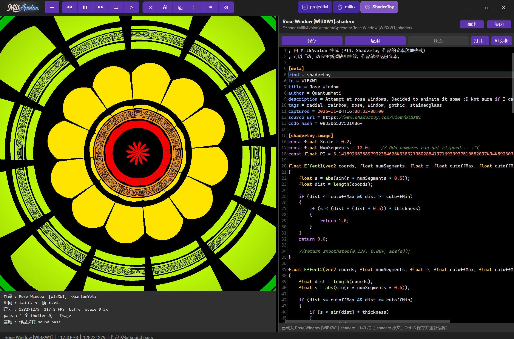
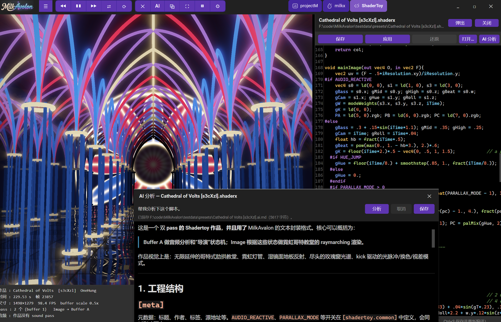

<div align="center">


**MilkDrop / projectM 与 ShaderToy 的 Avalonia 播放器**

Avalonia 12（ANGLE/EGL → D3D11）+ Silk.NET（OpenGL ES 3.0）

[](LICENSE)
[](https://dotnet.microsoft.com/)
[](https://avaloniaui.net/)
[](#运行要求)

</div>

---

## 这是什么

把上游 `MilkDropSharp` 里的两条播放线——
**projectM**（`.milk` 预设，EEL 表达式 + HLSL→GLSL 转译）和 **ShaderToy**（多 pass GLSL 工程）——
合并进一个 Avalonia 桌面应用，界面与输入完全由 Avalonia 负责，引擎源码原样复用（vendor + 最小补丁）。

渲染路径：Avalonia 用 ANGLE 建一个 OpenGL ES 3.0 上下文（底层 D3D11），Silk.NET 直接绑定到该上下文，
每帧把画面画进 Avalonia 交给控件的那个 FBO —— 没有额外的窗口、没有 GLFW、也没有 ImGui。

## 界面预览

<p align="center">
  
</p>
<p align="center">
  <sub>ShaderToy 页在播 <code>.shaderx</code> 作品；右侧是可拖宽的编辑面板（行号 / 语法高亮 / 参数导航 / 可弹出成独立窗口），左下角实时显示尺寸、FPS、pass 与音频状态</sub>
</p>

<p align="center">
  
</p>
<p align="center">
  <sub>「AI 分析」把当前脚本交给 DeepSeek，流式返回 Markdown 讲解，可保存成 <code>.md</code>；背后是同一个 <code>.shaderx</code> 工程在实时渲染</sub>
</p>

## 功能

**三个页签，点开即播**

| 页签 | 内容 | 格式 |
|---|---|---|
| `projectM` | MilkDrop 预设库（虚拟化列表 + 过滤 + 磁盘索引缓存），自动/手动切换、随机、重载 | `*.milk` |
| `milkx` | 脚本预设（`.milk` 转换而来的 C# 风格文本预设），可从目录/文件批量导入 | `*.milkx` |
| `ShaderToy` | 多 pass GLSL 工程，支持 buffer / sound / keyboard 通道 | `*.shaderx` |

- **切页即整页销毁重建**：GL 控件、引擎、音频一起拆掉再建，靠 `PageState` 快照续上时间与预设，重建后 GL 对象计数归零、不泄漏。
- **音频**：projectM 输入走 WASAPI 环回采集（无声卡时自动退到合成信号）；ShaderToy sound pass 输出按 `WASAPI → waveOut → 静音` 三级降级。
- **编辑面板**：右侧可拖宽的 AvaloniaEdit 编辑器，行号、语法高亮、补全、参数导航、查找，支持保存（写盘并重载）/ 应用 / 还原 / 弹出为独立窗口；`Ctrl+S` 保存。
- **AI 分析**：把当前脚本交给 DeepSeek（OpenAI 兼容接口）做流式讲解，结果用 Markdown 渲染；Key 填在设置里，或设环境变量 `DEEPSEEK_API_KEY`。
- **抓取**：内嵌 WebView2 打开 shadertoy 作品页抓取源码与贴图（落成 `.shaderx` + `media/`）；也可一键把当前画面存成 PNG。
- **桌面细节**：Material 暗色主题、自绘标题栏、F11 全屏、拖放文件即加载、DPI 自适应、设置持久化。

## 运行要求

- **Windows 10/11 x64**（ANGLE 原生库与 NAudio 后端都是 Windows 路径，暂不做跨平台）
- **.NET SDK 10.0** 及以上

## 快速开始

```powershell
git clone <repo-url> MilkAvalon
cd MilkAvalon

# 编译（整个解决方案）
dotnet build MilkAvalon.slnx

# 运行
dotnet run --project src/MilkAvalon
```

产物在 `src/MilkAvalon/bin/Debug/net10.0/MilkAvalon.exe`，可直接双击。

首次启动数据目录为空时会显示提示浮层，点「选择目录…」或到设置里指定数据根即可；
也可以用命令行临时指过去（不写设置）：

```powershell
MilkAvalon.exe --projectm-data "D:\media\MilkDropSharp\presets" --milkx-data ".\testdata\milkx" --shadertoy-data ".\testdata"
```

## 数据目录

数据根默认都在 exe 旁边，可在设置窗口里改，配置写进 `milkavalon.json`。

```
<exe>/
├─ MilkAvalon.exe
├─ milkavalon.json            ← 设置（数据根 / 网格 / buffer 模式 / 缩放 / API Key…）
├─ projectm/                  ← projectM 数据根
│   ├─ presets/**/*.milk      ← 预设（支持一层子目录；不存在 presets/ 时回退到根目录平铺）
│   ├─ textures/              ← 预设贴图
│   └─ res/                   ← 可选：MilkDrop3 的 shapes / 图片
├─ milkx/                     ← .milkx 脚本预设库
├─ shadertoy/                 ← ShaderToy 数据根
│   ├─ presets/**/*.shaderx   ← 作品=文本（唯一数据源，可 diff、可手改）
│   └─ media/media/a/*.png    ← 站点资源，按站点原路径存放
```

> ShaderToy 早期版本用 `shadertoy.db`，现在作品一律是 `presets/**/*.shaderx` 文本文件，数据库相关代码已整体移除。

## 设置项

`milkavalon.json` 里记录（camelCase），也可以直接在设置窗口里改：

| 设置 | 默认 | 说明 |
|---|---|---|
| `projectMDataRoot` / `shaderToyDataRoot` | `null` | 数据根，空则用 `<exe>/projectm`、`<exe>/shadertoy` |
| `milkxDirectory` | `null` | `.milkx` 库目录，空则用 `<exe>/milkx` |
| `meshWidth` / `meshHeight` | `48` / `36` | projectM 网格（预设里的 `nGridX` 可覆盖） |
| `shaderToyBufferMode` | `0` | `0` 跟随视口（与网页端一致）/ `1` 固定 1024×256 / `2` 半分辨率（省性能，部分作品会偏暗） |
| `vSync` | `true` | 是否启用垂直同步（帧节奏由 Avalonia 合成器控制） |
| `uiScale` | `1.0` | 界面缩放 |
| `deepSeekApiKey` / `deepSeekModel` | `null` | AI 分析用的 Key 与模型 |

## 命令行参数

命令行优先级高于设置文件。

| 参数 | 说明 |
|---|---|
| `--projectm-data <dir>` | 覆盖 projectM 数据根 |
| `--milkx-data <dir>` | 覆盖 `.milkx` 脚本目录 |
| `--shadertoy-data <dir>` | 覆盖 ShaderToy 数据根 |
| `--audio-backend auto\|wasapi\|waveout\|silent` | 选择 sound pass 输出后端 |
| `--tab projectm\|milkx\|shadertoy` | 启动时打开哪个页签 |
| `--preset <file>` / `--shader <id>` | 启动时直接加载某个预设 / 作品 |
| `--drop <file>` | 模拟拖放一个文件（`.milk` / `.milkx` / `.shaderx` / `.json`） |
| `--fullscreen` / `--editor` / `--settings` | 启动即全屏 / 展开编辑面板 / 打开设置 |
| `--capture <id\|url>` | 抓取一个站点作品并保存，然后退出 |
| `--import-milkx <dir>` | 批量把目录里的 `.milk` 转成 `.milkx`，然后退出 |
| `--ai <file>` | 对指定脚本跑一次 AI 分析 |
| `--shot <png>` | 自检截图：等引擎出 40 帧后截图并退出 |
| `--switch-test <n>` | 压测：自动来回切 n 次页并打印内存 / 句柄 / GL 对象 |
| `--synthetic-audio` | 用合成音频代替环回采集（无声卡 / 无人值守） |

`--shot` / `--switch-test` / `--capture` 等是开发自检用的，会在日志里打印结果。
想看逐帧 FPS 与尺寸，设环境变量 `MILKAVALON_VERBOSE=1` 启动。

## 快捷键

| 按键 | 作用 |
|---|---|
| `F11` / `Esc` | 进入 / 退出全屏 |
| `Ctrl+S` | 编辑面板保存（写盘并重新加载） |
| `Ctrl+F` | 编辑面板查找 |
| `Ctrl+Space` | 补全列表全量展开 |
| 双击画面 | 进入 / 退出全屏 |
| 拖放文件 | 直接加载预设（`.milk` / `.milkx` / `.shaderx` / projectM `.json` 工程） |

## 项目结构

```
MilkAvalon/
├─ src/
│  ├─ MilkAvalon/                  Avalonia 应用（界面、控件、服务、设置）
│  ├─ MilkDrop.ProjectM/           projectM 引擎：预设解析、EEL、渲染器、播放列表
│  ├─ MilkDrop.ShaderToy/          ShaderToy 引擎：pass 图、转译、通道、音频、.shaderx 读写
│  ├─ MilkDrop.PresetScript/       .milkx 脚本预设的读写与转换前端
│  ├─ MilkDrop.Rendering.Gles3/    GLES3 基础层：Framebuffer / Texture / Shader / Screenshot
│  ├─ MilkDrop.Eval/               EEL 词法、语法、字节码 VM、内建函数
│  └─ HlslParser/                  HLSL → GLSL 转译
├─ tests/                          xUnit 测试（Eval / PresetScript / ShaderToy）
├─ tools/MilkDrop.PresetConvert/   .milk ↔ .milkx 批量转换工具
├─ plan.md                         移植计划与逐阶段进度
└─ misc.md                         环境事实、API 备忘、踩坑与自检记录
```

引擎部分的改动刻意压到最小：`Framebuffer` 增加一个可配置的「默认 FBO」，让引擎把最终画面画进宿主提供的句柄；
`Screenshot` 增加读指定 FBO 的重载。其余都是 csproj 层面的依赖显式化，引擎语义零改动。

## 许可证与致谢

本项目以 **GNU General Public License v3.0** 发布，全文见 [LICENSE](LICENSE)。

- 引擎与播放逻辑来自上游 `MilkDropSharp`（GPLv3），本仓库是其 Avalonia UI 移植分支（引擎源码搬入后仅打最小补丁）；
- 预设与渲染思路源自 [projectM](https://github.com/projectM-visualizer/projectm) / MilkDrop（Winamp）；
- ShaderToy 相关格式与抓取逻辑对齐 [shadertoy.com](https://www.shadertoy.com/) 的作品结构。

Copyright (C) 2026 sevencat
